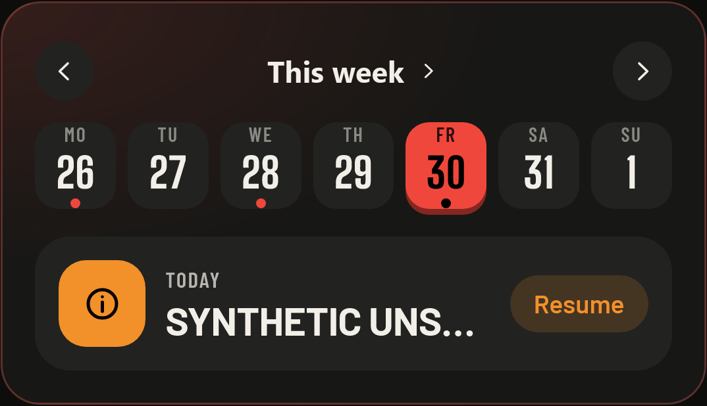
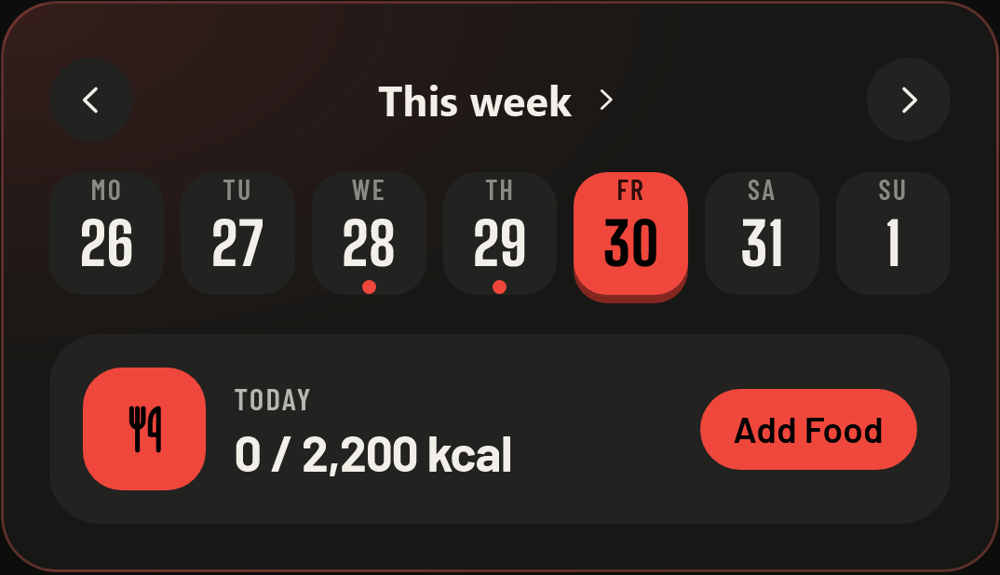

# TGym 1.15.104 experience and notification audit

Published release: **1.15.104 / Android 140**, runtime source `962e26262e1c1083900e35bd5acfe9782e774d4f`. [GitHub Release](https://github.com/Truesilverking/TGym/releases/tag/v1.15.104) and [public PWA](https://truesilverking.github.io/TGym/) are verified against the released files.

Final-source CI passes, including **2,955 frontend tests / 255 files** and **52 Android instrumented tests**. The compiled Workout check passes **24 cases / 126 checks**. Four actual-public Edge/WebKit cases pass with no observed JavaScript errors and preserved synthetic state. GitHub/Pages APK bytes match; all **77 deployed PWA files** and **81 shared candidate/runtime assets** are exact. Update-topic notifications were explicitly skipped by the annotated tag policy.

The [structured evidence](EXPERIENCE-EVIDENCE-1.15.104.json) separates final-source/public verification from earlier broad browser checks and Pixel QA on source `6243142`. The user waived further Pixel access; the final device repeat and original app installation were not performed. Physical iPhone/native iOS acceptance is not claimed, and Windows WebKit offline cold-open retains its documented engine limit.

## Resulting behavior

Today, Routine, Nutrition and Stats form a horizontal navigation sequence. Routine includes its exercise library; Stats visits the selected analytics pages and its records, history and report pages. Swiping beyond the end of Stats continues to the neighboring module. Only Start/Resume and a discreet navigation handle remain visible while the dock is collapsed on main screens. Workout hides the dock completely and provides a separate 44px Back action returning Home without ending, discarding or pausing the active session. This safe exit also appears on the empty chooser and training-pause view; Discard and Finish remain separate. Lifting the dock reveals Today, Routine, Nutrition and Stats for direct navigation; choosing a module closes it. There are no selection chevrons on those buttons, and the central action stays in the same position. The Stats arrow both changes page order and opens the selected page. Existing section preferences remain compatible.

Stats no longer repeats the current section name above its own content title. The position counter remains visible at the right, with the section name retained for assistive technology. Each section keeps its own title, and the floating selector continues to jump to sections, select them and change their order.

Swipes track the pointer directly, then animate the outgoing page for 140ms and the incoming page from the opposite side for 180ms. Reduced motion navigates immediately. Pending transitions cannot override a later direct navigation. Visited pages retain local dates, chart filters, comparison selections and report choices. Hidden React Activity pages stop their effects. Workout entry, settings, authentication and routine editors remain outside the swipe sequence. Form controls, charts, calendars, sheets and OS edge gestures retain their own input.

Training Calendar retains its status semantics and removes only the Today/Future legend entries. The tracking-start caption appears when its date belongs to the displayed period. Active-day counters retain their number and accessible label. Today and Nutrition render the same shared compact seven-day calendar, with matching week arrows and an expandable header. Nutrition marks food/water logs and selects a day directly; its header opens the shared week/month/year calendar sheet for distant dates. The compact seven-day strip retains its width and uses squarer day targets. Streak flames are larger. Settings and Workout hide the complete navigation dock, including Start/Resume and the lift handle; returning to a main screen restores the collapsed dock without changing the active workout.

App lock uses a compact card with four masked PIN slots, a numeric keypad, deletion and optional key visibility. A single labeled input retains keyboard and paste support; completing four fresh digits verifies automatically, including leading zeroes. Recovery remains a separate text-entry mode with an explicit Unlock action. Its existing one-time key still removes the device lock. Biometric cancellation keeps private content locked, announces the fallback and restores PIN focus. A persisted retry delay disables PIN entry and shows the remaining seconds while recovery and configured biometrics remain available. Operation tokens prevent a verification from an earlier lock cycle from opening a newly locked session, and StrictMode effect replay retains one biometric request. Backgrounding clears and masks partial keys; returning after five minutes resets to PIN mode. Document visibility and native App activity are combined so an Android Activity that backgrounds while its WebView still reports visible remains protected; duplicate events cannot restart the timeout, and stale native snapshots cannot override newer events.

The lock keeps its device-local storage key, salted PIN and recovery hash format, recovery contract and progressive attempt policy. Pending PIN, recovery, enrollment and biometric operations recheck the current credential before applying a result. A canceled or superseded recovery cannot remove a newer lock, and PIN verification preserves live attempt counts and biometric preferences. No stored PIN or application-data migration is introduced. Local browser checks and mocked native tests do not establish physical fingerprint/Face ID or assistive-technology acceptance.

The in-app reminder feed and its configuration are removed from reachable UI. External reminders and their preferences remain available. Android alerts use improved PCM tones and transient ducking audio focus, while preserving the user's channel, silence, volume and vibration choices. PWA timers use foreground Web Audio or background OS notifications, with occurrence-based deduplication. Authenticated web clients with an existing Push subscription can schedule independent server rest/work alarms and cancel them. Static closed PWAs cannot schedule future browser wakeups by themselves; browser/OS notification tones remain system-controlled.

Original gray/black anatomical 512px GIFs with targeted red muscle regions and matching still posters cover twelve recognized custom-exercise variants, plus the separate StepMill timed-walk variant. Existing uploaded media always takes precedence. Artwork is resolved at display time; it does not rewrite custom IDs, routine references, history or profile media, and does not consume profile JSON quota. Unknown or contrary variants retain their prior placeholder. The calf illustration follows the routine's per-side configuration and the owner's standing clarification, with a bent supporting knee; hip thrust uses a dedicated machine; overhead extension is standing with a curved EZ attachment. Other demonstrated variants include a knee raise rather than a straight-leg raise, unilateral suitcase carry, flat-ground walking and isometric holds rather than dynamic repetitions.

Original renderer sources, provenance, decoded-file checks and reviewed hashes are in `frontend/scripts/original-exercises/`. No external photographs, GIFs, traced frames or bitmap inputs were used. User-specific profile identifiers are absent from the media registry and assets.

## Defects found and corrected

- Android touch capture transferred from a child to the swipe region and bubbled a lost-capture event that cancelled navigation. Only capture loss on the region itself now cancels that gesture.
- Retained analytics could keep an error fallback after leaving and revisiting the page. Boundaries now retry on route changes and Activity class reactivation, without offering to discard a workout from unrelated modules.
- Returning to a retained report could expose a revoked Blob URL, lose comparison selections, or leave an export dialog in the browser top layer. URLs are recreated while visible, selections survive unchanged data, dialogs close while hidden, and hidden generation cannot auto-download.
- Body-comparison dates could reset when an Activity effect restarted without any measurement change. Reset now requires an actual data change.
- Input-only workout clocks could invalidate a report. Reports now reuse the existing stable Stats snapshot, while meaningful training/body/routine/media edits still invalidate stale output.
- Re-selecting the same menu anchor after scrolling did not jump again. Anchor scrolling now observes each navigation occurrence.
- The new page-order preference was absent from initial API-profile rebasing. It now remains a preference rather than an array of merged records.
- Windows WebKit loaded the variable display font but rasterized thin glyphs for requested heavy weights. Equivalent static 800/900 instances of the same bundled OFL font preserve advances and fix the confirmed rendering issue.
- Timer alerts could duplicate between foreground audio, background page notification and Push, or silently replace a previous real timer. The worker serializes delivery and records each deadline; duplicate Push refreshes remain visible and silent, while a new timer can alert again.
- Notification links are limited to supported same-origin routes. Cancelled/replaced server jobs cannot emit late callbacks. Permission requests require an explicit user gesture, and denied notification permission does not block native timer/service synchronization.
- Static-photo and unillustrated exercises no longer start an offscreen GIF decoder against a nonexistent directory URL. Animated uploads, bundled animations and catalog GIFs retain playback/pause behavior.
- The backend Docker COPY list now includes the new timer module.
- The collapsed navigation reserves the visible hexagon's full height, preventing overlap with the rest timer. Android Back closes the expanded dock before navigating history, while locked sheets retain priority.
- Cancelling biometrics could leave the PIN field enabled without returning focus. The lock now announces cancellation and restores focus after controls become available; an active PIN cooldown keeps its countdown visible instead of suggesting unavailable input.
- A pending verification could finish after a later five-minute relock. The lock now ignores results from the older operation. Its effect cleanup also preserves a live biometric operation during StrictMode replay without accepting results after a real unmount.
- Stats repeated its section name above the section's existing title. Only that duplicate visible label is removed; the counter, accessible section name, section title and floating selector remain.

- Reproduced pending-authentication races could restore an older PIN, lose a biometric preference or failed attempt, remove a newer lock, or accept an obsolete biometric result. The helpers now re-read the live lock before a result is applied, preserve unrelated live fields, and reject superseded credentials. Recovery also requires its initiating UI operation to remain current; native and browser regression tests retain unchanged credentials and profile data.

- Android warm notification taps opened the app without reaching the workout because the Intent lacked ACTION_VIEW. The service now sends an explicit view Intent, and a persistent in-memory frontend inbox retains valid workout taps while the PIN screen or profile hydration is pending; unlocked Shell consumes each request once using current workout state.
- Native inactivity pause updated notification state but left the custom view labeled Workout. Compact/expanded views and the normal title now show the localized pause label while retaining set context and an independent rest countdown.
- Start/Resume remained above Settings and Workout. The dock now leaves those full-screen flows and its focus/back handlers are released; returning restores the collapsed main navigation.

## Verification coverage

- Final source `962e262`: **2,955 frontend tests / 255 files**, **52/0/0 Android instrumented tests**, and **24 compiled Workout cases / 126 checks** pass. Required Tests/API/MCP/catalog, PWA, Android, signed-candidate and release workflows succeed.
- Broader local baseline on `6243142`: API **24**, MCP **38** plus the plain-Node import graph, catalog **6**, **2,187** synchronized locale keys / **1,383** source strings, **108,000** fatigue comparisons and **14,076** history-deletion comparisons pass. Source provenance is retained in the structured record.
- The earlier compiled matrix on `6243142` passes **32 combinations / 352 checks**, including Settings without a dock in all 32 cases. AppLock passes **34 browser cases plus 4 adversarial cases** with mocked biometrics. These are historical checks, not a final physical-iPhone acceptance record.
- All **26 original media assets** (13 GIFs and 13 posters) retain 512px dimensions and reviewed/reproduced raw hashes. Each GIF decodes 36 looping frames; all **468** rig records preserve their geometry. Twelve variants serve recognized production custom exercises; StepMill remains separate. Combined size: **5,103,736 bytes**.
- Web/PWA/mobile synchronization and Android compilation/lint pass. Native iOS is not built on Windows. Private backups, profile identifiers/checksums, inventories and device screenshots are excluded from this record and Git.

## PWA update and browser evidence

The historical compiled `6243142` browser matrix passes all **32 combinations / 352 checks** across Edge and Windows WebKit with an iPhone user agent: 320px, 390px, 430px and 844x390 landscape; light/dark themes; normal/reduced motion. Every case requires a ready worker, preserves the protected synthetic collections and checks for runtime errors. Six complete isolated runs consolidate 32 unique cases without interrupted or duplicate cases. This includes the Stats counter without a duplicate visible name, the shared compact Nutrition calendar and Settings with no dock/Start/handle/backdrop, zero navigation clearance and a collapsed dock on returning Home. Earlier v2/v5 evidence retains its original source identity.

The normal Settings Check for updates → Update path from the authentic public 1.15.103 build preserves the complete portable profile, valid pre-update CRC backup, IndexedDB mirror, legacy precise numeric strings and a large embedded media resource in Edge and WebKit. Edge also passes closing/reopening a new tab offline with the updated worker.

Windows WebKit's offline mode fails both public 1.15.103 and 1.15.104 despite an activated controller and cached shell. An independent minimal service worker returning static HTML without TGym, fetch or CacheAPI reproduces the same failure; Edge passes that control. Therefore WebKit offline cold-open acceptance is **not verifiable in this test engine**. Its failed test and independent-control evidence are retained, rather than relabeled as passing.

WebKit automation is not a physical iPhone or an installed iOS PWA. Native iOS compilation requires macOS/Xcode; the Windows Capacitor synchronization is not an iOS build.

## Synthetic visual references

These images contain isolated synthetic fixtures and no phone profile or private device screenshots. Nine earlier app screenshots are historical and come from the exact compiled final-v6 PWA at `6243142e49959a57d3ed567965ed0acf2e7a8b0d`, in Windows WebKit with an iPhone user agent at a 390px viewport and a ready service worker. The six full-page views come from a completed passing matrix case; the two compact calendars were captured in a separate passing comparison, and the AppLock view comes from the dedicated passing lock audit against that same build. They replace the earlier development previews. The additional Workout screenshot is current compiled source `962e262`, using an isolated synthetic fixture in Windows WebKit with an iPhone UA at 390x844; it shows the safe Back action and no dock. The [structured evidence](EXPERIENCE-EVIDENCE-1.15.104.json) records their coverage and remaining acceptance limits.

| View | Synthetic preview | Capture basis |
| --- | --- | --- |
| Today, enlarged streak flame and collapsed dock | [PNG](experience-1.15.104/webkit-home.png) | Compiled final-v6 / `6243142` |
| Nutrition with the shared compact calendar | [PNG](experience-1.15.104/webkit-nutrition.png) | Compiled final-v6 / `6243142` |
| Training Calendar sheet | [PNG](experience-1.15.104/webkit-training-calendar.png) | Compiled final-v6 / `6243142` |
| Stats with only the position above its content | [PNG](experience-1.15.104/webkit-stats.png) | Compiled final-v6 / `6243142` |
| Floating section selection and ordering | [PNG](experience-1.15.104/webkit-stats-menu.png) | Compiled final-v6 / `6243142` |
| Settings without the dock or reserved navigation space | [PNG](experience-1.15.104/webkit-settings.png) | Compiled final-v6 / `6243142` |
| Modern app lock with an empty masked PIN and keypad | [PNG](experience-1.15.104/webkit-app-lock.png) | Compiled final-v6 / `6243142`; synthetic biometric-cancellation case |
| Workout with a safe Back action and no dock | [PNG](experience-1.15.104/webkit-workout-back.png) | Current compiled web-v9-final / `962e262`; synthetic cold route |
| Original gray anatomy and red muscle illustrations | [PNG](experience-1.15.104/original-exercise-preview.png) | Approved anatomical renderer preview; separate from the recorded app screenshots |

Today and Nutrition use the same header, arrows and seven day targets; their marks and summary row reflect their respective data:

| Today | Nutrition |
| --- | --- |
|  |  |

## Final device, CI and publication results

Historical runtime [`6243142`](https://github.com/Truesilverking/TGym/commit/6243142e49959a57d3ed567965ed0acf2e7a8b0d) was installed and identity-verified in the isolated Pixel QA app. Completed focused cases observed no JavaScript runtime errors: Settings had no dock, anatomical media rendered distinct frames, the 60-second auto-pause boundary and visible pause label agreed, and a notification tap while locked reached PIN and then Workout. Protected QA state stayed unchanged, web/native copies agreed, the workout clock delta was zero and the manual pause remained intact. Temporary test PIN/rest and device settings were restored.

A direct warm-notification case stopped safely after the foreground changed and was not counted as passing; no app failure was established. An immediate ADB force-stop after temporary PIN Save, before lifecycle handoff, lost the temporary key. Normal backgrounding/cold reopen retained it. The raw limit remains recorded without a regression claim.

The user then requested publication without further Pixel access. The final Workout dock/Back and native color/foreground-service changes have no final physical-device repeat; the original phone app has not been updated. Those checks remain explicit limits rather than publication gates. Physical iPhone, native iOS and actual fingerprint/Face ID acceptance are not established.

## Final-source verification

Final source `962e26262e1c1083900e35bd5acfe9782e774d4f` passes **2,955 frontend tests / 255 files** and the compiled Workout check: **24 cases / 126 checks**, with **0 observed JavaScript runtime errors**. Edge and Windows WebKit with an iPhone UA cover 320px, 390px and 844x390 landscape. Every case opens Workout directly, without a prior Home visit: active sessions with/without rest, the empty chooser and the training-pause view. The real 44px Back action returns Home; main Resume returns to Workout and Back works again. Discard and Finish remain separate. Workout has no dock/handle/backdrop or reserved navigation clearance. RestTimer owns its visible height and retains unobstructed targets. Protected synthetic state, manual pause, exact rest deadline and precise load strings survive navigation except for interaction/store timestamps.

All required exact-source CI runs succeed: [Tests push](https://github.com/Truesilverking/TGym/actions/runs/41114036536), [Tests PR](https://github.com/Truesilverking/TGym/actions/runs/41114044960), [PWA](https://github.com/Truesilverking/TGym/actions/runs/41114036578), [Android](https://github.com/Truesilverking/TGym/actions/runs/41114036481) and [signed candidate](https://github.com/Truesilverking/TGym/actions/runs/41114037045). The downloaded Android report is complete and verified: **52 passed / 0 failed / 0 skipped**. It includes missing/blank/malformed accent fallback, explicit view Intent, cold foreground-service startup and audio-focus cleanup regressions.

The production candidate APK/AAB are verified for the exact source, version 104/code140, production signing continuity, non-debuggable state and **83 assets** including dexopt. APK SHA-256: `01e39e8f15ccb428db00b6d2490ca9447aebc91d7b4c7df8cfa85dfcd640eca6`; AAB: `a48e7a9d61287f11f284263605216002876b55659f96e7f9c9948cf326268ca7`. The later public comparison verifies signing and shared runtime identity; APK packaging bytes are not assumed identical.

The annotated `v1.15.104` tag points to exact source `962e262` (tag object `a1e71497c29bd2180a9aefe7753035dd2cdcbac5`). The [release workflow](https://github.com/Truesilverking/TGym/actions/runs/41114915021) succeeds and publishes release 429411600 with four assets. Its update-topic send step is explicitly skipped, as requested by the tag marker; no update-notification delivery is claimed.

## Public artifact and browser verification

Independent public downloads verify the version, source, official signing continuity and non-debuggable production package. Release and Pages APKs are byte-identical: SHA-256 `4de52615821b696a65b5f577e32f00c5c60f8f591807c97ca4ebc0e868678569`. The AAB SHA-256 is `a48e7a9d61287f11f284263605216002876b55659f96e7f9c9948cf326268ca7`, identical to the verified final candidate. All **77** deployed PWA/metadata files match the release build, and **81** shared candidate/runtime assets match. Candidate APK packaging bytes differ from the final public APK; source, assets and signing identity are verified separately.

The actual public site passes **four isolated synthetic browser cases**: the main route and Workout/Back route in Edge and Windows WebKit. Nutrition shows seven compact calendar targets, Stats has no duplicate upper section label, Settings has no dock, and the actual 512px anatomical poster/GIF decode under the production base path. Update checking does not reoffer the installed build. Main persisted profile strings remain exact; Workout comparisons exclude only store/interaction timestamps and preserve manual pause, numeric precision and the active draft. Real Back returns Home and restores collapsed Resume. All four cases observe zero JavaScript runtime errors.

Edge also closes/reopens a fresh tab offline with the updated worker and unchanged synthetic profile. Windows WebKit offline cold-open remains unclaimed because the independent earlier minimal-worker control reproduces its engine failure. These checks are not physical Safari/iPhone or native iOS acceptance. The original phone installation and final physical repeat remain waived/unperformed. Protected `main` retains independent review.

## Historical native findings

Earlier native failures remain historical: `6243142` passed 34, failed 1 and did not execute/aborted 16 of 51 planned tests due to blank accent parsing. Intermediate `1ed9e24` completed 52 with 50 passed and 2 failed, exposing OS-deferred foreground visibility and a non-atomic test cleanup read. The service now requests immediate foreground visibility while retaining LOW importance and silence; the test reads four cleanup fields atomically and polls within three seconds. Intermediate `252590b` subsequently passed all 52; the final source independently repeats that full pass.
