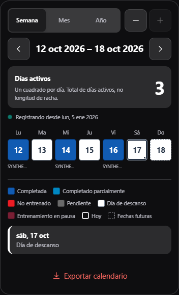
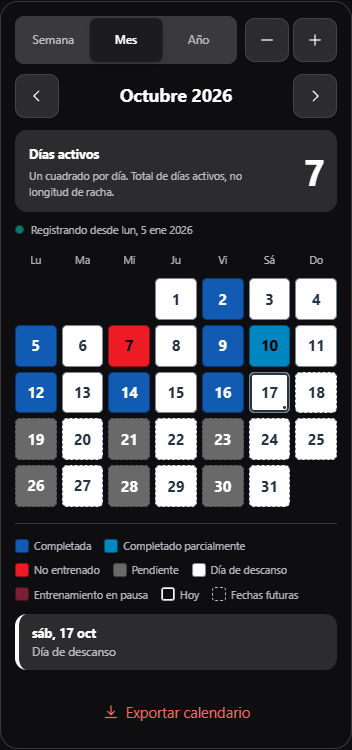
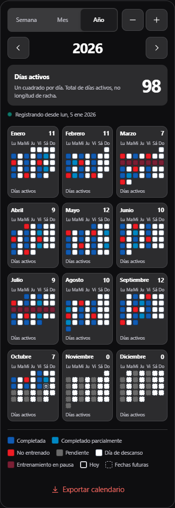

# TGym 1.15.76 / Android 112

Fuente del runtime: `eb2813487803bec1dc47b92988965873805dfd82`, rama `feature/streak-calendar-1.15.76`. El calendario de Streak abre el año seleccionado con doce meses de enero a diciembre. Semana, mes y año comparten celdas, paleta, tipografía, controles y marcadores temporales. El total del período y los contadores mensuales cuentan fechas con actividad válida; la racha actual y la mejor racha mantienen sus reglas y cifras independientes.

El año usa tres columnas cuando hay espacio y reduce a dos/una en contenedores estrechos. Hay una celda cuadrada por día real, alineación lunes–domingo, navegación por años y acceso al mes y al historial. Hoy conserva un contorno interior, selección un punto y futuro borde discontinuo. Las fechas y estados accesibles se conservan en los mini calendarios aunque se omitan sus números visuales a ancho de teléfono. No se modifican almacenamiento, IDs, historial, zona horaria, cálculos ni formatos exportables. Diseño y matriz detallada: [STREAK-CALENDAR-AUDIT-1.15.76.md](STREAK-CALENDAR-AUDIT-1.15.76.md).

## Paleta conservada

| Estado | Fondo | Texto | Borde |
| --- | --- | --- | --- |
| Actividad/Completada | `#115BB2` | `#FFFFFF` | `#073977` |
| Parcial | `#0087C2` | `#000000` | `#00547A` |
| No entrenado | `#ED1C24` | `#000000` | `#8F1015` |
| Pendiente | `#696969` | `#FFFFFF` | `#424242` |
| Descanso | `#FFFFFF` | `#263345` | `#7B8796` |
| Entrenamiento pausado | `#791F34` | `#FFFFFF` | `#4B1020` |

El inicio de registro usa su indicador externo `#0F766E`/borde `#064E3B` y fecha localizada. Las fechas anteriores siguen visibles con estilo de Descanso; su estado interno `untracked` y sus exclusiones estadísticas se conservan. No se muestra una categoría Not Tracking Yet. Parcial conserva la regla confirmada y su color pedido.

## Capturas de las tres vistas

Muestras españolas con datos sintéticos de la URL pública, viewport de teléfono de 390 px; la altura de captura se amplía para mostrar la tarjeta entera sin recortarla. No son capturas de un dispositivo físico. Las comprobaciones de desbordamiento se hacen además en viewports normales.

| Semana | Mes | Año |
| --- | --- | --- |
| [Abrir semana](assets/streak-calendar-1.15.76/semana.png) | [Abrir mes](assets/streak-calendar-1.15.76/mes.png) | [Abrir año](assets/streak-calendar-1.15.76/anual.png) |
|  |  |  |

## Validación local y regresiones

| Comprobación | Resultado |
| --- | --- |
| Instalación | `pnpm install --frozen-lockfile`, lockfile intacto |
| Frontend completo final | 2130/2130, 192 archivos; cuatro workers, sin aumentar timeouts ni debilitar aserciones |
| Foco calendario/actividad | 47/47; años bisiestos 2024/2000/2100, meses y offsets, duplicados, Parcial, extras, inválidos, cancelaciones, calentamientos, futuro, persistencia y fecha local |
| Regresión CSS real | Leyenda de futuro y celdas con borde calculado discontinuo |
| Builds exactos | Web, PWA y móvil/Capacitor sync aprobados para la fuente final |
| Android local | JDK 21/SDK 35, `assembleDebug :app:lintDebug`, 386 tareas, 39 ejecutadas, 347 actualizadas, 26 s |
| iOS | Sync de recursos; no compilación nativa en Windows |

No hay scripts frontend de lint/typecheck. La primera corrida local por defecto tuvo cuatro timeouts de Excel de 5 s bajo carga. Con cuatro workers se aprobó inicialmente 2129/2129 y, tras añadir la regresión CSS, 2130/2130. No se ocultaron aquellos fallos ni se cambiaron sus aserciones/plazos.

Se detectaron dos defectos visuales durante la validación: la leyenda heredaba el texto del tema, y el selector general de borde hacía sólida la clave de Fechas futuras mientras sus celdas eran discontinuas. Se restauró el color explícito de la leyenda y se corrigió la especificidad del borde. La matriz visual y el guard calculado de navegador, más el test con CSS real, previenen su regresión. El primer commit `d839c78` y sus CI quedan archivados como antecedentes, no como aceptación de la fuente final.

## Matriz del cambio

Perfiles sintéticos aislados; las rutas de evidencia corresponden a `.tools/calendar76/`. La auditoría integral previa y sus pendientes siguen en [APP-AUDIT-2026-10-19.md](APP-AUDIT-2026-10-19.md); este cambio no representa una nueva certificación física de toda la app.

| Función | Escenario | Esperado | Observado | Evidencia | Estado |
| --- | --- | --- | --- | --- | --- |
| Año y contadores | 365/366 fechas, meses 28–31 días, varias rutinas/sesiones y Parcial | Una fecha válida como máximo por día, suma mensual=anual, racha independiente | Fechas reales, offsets y contadores coinciden entre escalas | `calendar-view.test.js`, `ZoomCalendar.test.jsx`, `source-acceptance/fixture-ui-proof.json` | Aprobado |
| Reglas/estadísticas | Ocho fixtures × tres horas contra fuente exacta 75 | Misma salida e input intacto | 192 Streak, 96 calendarios, 24 Consistency y 24 trainingStreak exactamente iguales | `metrics-proof.json` | Aprobado |
| Visual compartido | Dos motores × tres escalas × cuatro anchos × dos temas × tres acentos | Cuadrados, paleta fija, sin solapamientos/desbordamientos | 144 combinaciones y cero errores observados; no incluían el guard de borde de leyenda futuro | `source-acceptance/proof.json` | Aprobado, navegador/emulación |
| Contenedor/fecha local | Anchos 200/290/360/670, UTC−/UTC+, DST y pageshow | Adaptación 1/2/3 columnas y refresco local | Ocho contenedores, calendario y cambio de fecha correctos | `source-acceptance/responsive-ui-proof.json`, tests de fecha | Aprobado |
| Borde temporal final | Edge/WebKit × claro/oscuro y CSS real | Futuro discontinuo en celda y leyenda | Cuatro casos DEV y guard explícito en los 36 casos del build final | `source-acceptance/future-legend-fix-proof.json`, `built-calendar-acceptance/proof.json` | Aprobado |
| UI fuente final | Dos motores × tres vistas × tres anchos × dos temas, navegación 2024–2027, detalle y recarga | Metadata final, interacción y datos intactos | 36/36, worker correcto y cero errores | `built-calendar-acceptance/proof.json` | Aprobado |
| Reportes existentes | Preview, guardar, compartir/cancelar PDF/PNG/combinados | Paleta, fechas, geometría y métricas conservadas | Diez archivos descargados abiertos, ocho páginas Poppler, cuatro PNG idénticos a 75 | `built-acceptance/{proof,file-review-proof,retained75-report-png-parity}.json` | Aprobado |

## Publicación y comprobación pública

Publicado el 20 de octubre de 2026: [release 1.15.76](https://github.com/Truesilverking/TGym/releases/tag/v1.15.76) y [workflow 39443765992](https://github.com/Truesilverking/TGym/actions/runs/39443765992) aprobados. Tag anotado remoto `df67bfc85d09278b2c12893f12076728cf67ce5a` apunta a la fuente final `eb2813487803bec1dc47b92988965873805dfd82`. El cierre documental posterior conserva esa fuente del runtime.

| Puerta anterior al tag | Resultado |
| --- | --- |
| [Tests 39442772082](https://github.com/Truesilverking/TGym/actions/runs/39442772082) | 2130 frontend / 192 archivos, 16 API, 37 MCP + carga Node, 6 catálogo; 12 locales × 1922 claves / 1218 cadenas; 108000 comparaciones de fatiga / 14076 eliminaciones de historial |
| [PWA 39442775961](https://github.com/Truesilverking/TGym/actions/runs/39442775961) | CRC, metadata y digest de caché verificados; artefacto 12273988312 |
| [Android 39442779428](https://github.com/Truesilverking/TGym/actions/runs/39442779428) | Build/lint y 11/0/0 en emulador Android 15; artefacto 12274938504 |
| [Candidato 39442783565](https://github.com/Truesilverking/TGym/actions/runs/39442783565) | APK/AAB firmados, lintRelease, versión 112, identidad y firma oficial; artefacto 12274977998 |

`pages.yml` omite las tres variables públicas explícitas del release: 31/50 assets son binariamente iguales a la variante local de producción; el index cambia esos valores y 18 chunks sus referencias derivadas. Los 50 normalizan exactamente. Esto se distingue de la paridad pública de producción posterior: **los 50 assets compilados públicos son byte por byte iguales al PWA local exacto aceptado**. Se explican aparte 6 diferencias estáticas de formato/saltos de línea/JSON/digest derivado; no se afirma igualdad binaria del shell entero.

| Artefacto público | Bytes | SHA-256 |
| --- | --- | --- |
| APK GitHub/Pages, idénticos | 9033663 | `1e2d221ea81b93a9ae8b38c494e1fa343d628eb9002a17cd12f570a996708f52` |
| AAB | 8082404 | `41f3c00faa3230768b959843fe36410de48566141b36ac14456446695c42b5ab` |

CRC, checksums, firma APK/JAR del AAB y continuidad oficial verificados. Se conserva `app.framegym.mobile`, min SDK 23, target/compile SDK 35 y paquete no depurable. Certificado SHA-256: `8ee233c984615e2b3f6f083dc0c47d148bb8956ff7caca97be0b9a0d260e6082`. Los 61 recursos web APK/AAB/candidato coinciden. La comparación del ZIP completo del candidato se registra separada del contenido del runtime en `candidate-public-comparison.json` y `candidate-public-apk-entries.json`; se distingue un cambio de bloque de firma de un cambio de la app.

El manifiesto público, APK y `build.json` indican 76/112/eb28134. Los 57 recursos del shell se verificaron por digest contra la plantilla de esa fuente; worker: `tgym-app-1.15.76-eb2813487803bec1dc47b92988965873805dfd82-04ed90cf5f56`. Ambos actualizadores ofrecen 76 desde 75 y no repiten oferta desde 76. La URL pública se abrió con perfiles nuevos de Edge y WebKit, metadata/worker correctos, 36/36 casos visuales con el guard explícito de leyenda futuro, navegación y detalle; diez archivos nuevos descargados y ocho páginas Poppler abiertos, cuatro PNG exportados iguales al build final. Las tres capturas anteriores proceden de esa URL pública.

La comparación adicional de las capturas UI de semana/mes/año contó 4/10/25 píxeles diferentes respecto al build, con igual tamaño y geometría. No se declara identidad binaria de esas capturas de pantalla. Los cuatro PNG exportados sí son byte por byte iguales; ambas comprobaciones se registran por separado en `published-acceptance/{exact-built-png-match,calendar-card-pixel-comparison}.json`.

| Función | Escenario | Esperado | Observado | Evidencia | Estado |
| --- | --- | --- | --- | --- | --- |
| Actualizar/offline exacto | 75→76, normal/pausada × Edge/WebKit, cierre/reapertura | Backup y datos intactos, caché exacta, sesión sin finalizar | Cuatro perfiles nuevos aprobados; pausa 9:00, una serie hecha y otra pendiente, sin historial añadido | `exact-pwa-acceptance-eb28134.json` | Aprobado, origen local |
| Exportar offline exacto | Full, varios años y PNG semanal | Archivos válidos, paleta y geometría conservadas | 16 descargas abiertas; 52 imágenes PDF + 4 PNG idénticas a referencia anterior; 8 páginas nuevas Poppler y 4 PNG abiertos | `pwa-exacteb28134-file-review/proof.json` | Aprobado |
| Publicación/actualizador | Descargar GitHub/Pages y comprobar 75/76 | Mismos archivos y firma, actualización solo nueva | Hashes/identidad/versión/fuente y cuatro checks correctos | `public-artifacts-verified.json`, `updater-verified.json` | Aprobado |
| URL pública real | 36 casos, diez descargas, preview/guardar/compartir cancelado | Mismo calendario, reportes y worker final | 36/36, leyenda futura discontinua; 8 páginas revisadas, 4 PNG iguales al build | `published-calendar-acceptance/proof.json`, `published-acceptance/{proof,file-review-proof}.json` | Aprobado, navegador/emulación |
| Shell público/offline | 75→76, normal/pausada × dos motores, cierre/reapertura | Backup, perfil y sesión intactos; archivos iguales al build exacto | Cuatro perfiles nuevos aprobados; 16 archivos, 52 imágenes PDF + 4 PNG idénticos al exacto final, 8 páginas nuevas renderizadas | `public-pwa-acceptance.json` | Aprobado, shell público servido localmente |

El tag normal habilitó el mecanismo existente de aviso. FCM aceptó ambos topics una sola vez; no hubo reintentos ni reenvíos. Logs seguros con hora UTC (Santo Domingo = UTC−4):

`2026-10-20T15:02:10.6480989Z FCM accepted tgym_updates update notification: [FCM message ID omitted]`

`2026-10-20T15:02:10.8511140Z FCM accepted tgym_updates_v2 update notification: [FCM message ID omitted]`

Esto demuestra aceptación del servicio, no recepción, toque o instalación en teléfono físico. El registro estructurado de checks, hashes y límites está en [AUDIT-EVIDENCE-1.15.76.json](AUDIT-EVIDENCE-1.15.76.json).

## Límites y pendientes concretos

Edge de escritorio, WebKit móvil emulado y emulador Android son evidencia distinta de dispositivo real. No hay teléfono ADB conectado. Quedan pendientes iPhone/Safari/PWA instalada, compartir nativo iOS y recepción/toque/instalación de la actualización en teléfono físico. Aceptación FCM no equivale a recepción física. Las pruebas de compartir guardan/cancelan localmente y no envían documentos a terceros.

WebKit offline se valida cerrando el navegador completo y deteniendo el origen servido localmente; `navigator.onLine` sigue true en ese harness. Edge se reabre con red emulada offline. Los dos escenarios conservan caché y datos, pero no demuestran desconexión de un iPhone físico.
